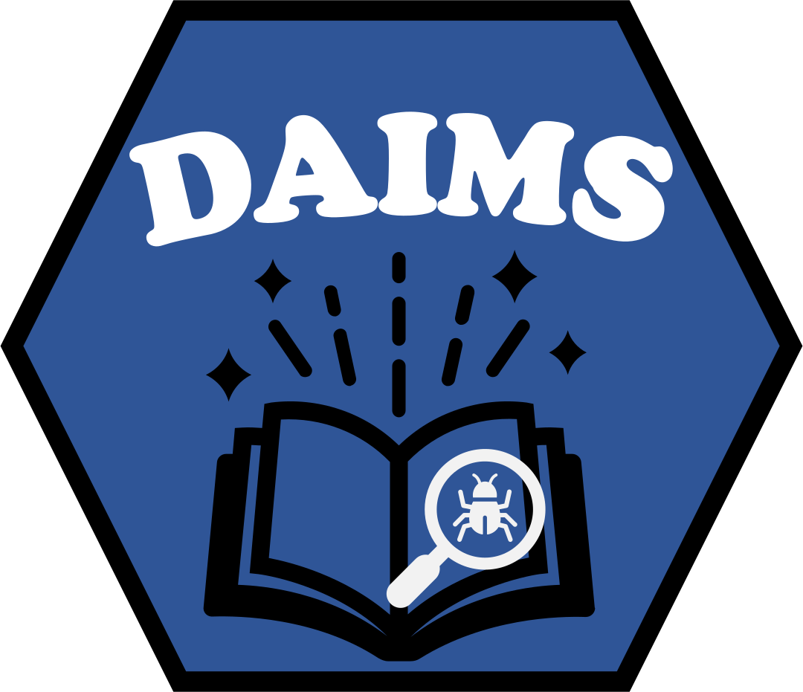

# DAIMS: Datasheets for AI and Medical Datasets  

<p align="center">
  
</p>  

  
  
  
  
[](https://huggingface.co/spaces/ramtinzm/DAIMS)

Despite progress in data engineering, inconsistencies in data validation and documentation procedures continue to cause confusion and technical challenges in research involving machine learning (ML). While frameworks like **Datasheets for Datasets** have made strides in addressing these challenges, there is room for improvement to better prepare datasets for ML pipelines.  

To bridge this gap, we introduce **DAIMS**: Datasheets for AI and Medical Datasets. DAIMS extends the foundational framework with additional tools and guidance tailored specifically for medical datasets and AI applications.  

## Key Features  

1. **Comprehensive Checklist**  
   A 24-point checklist that covers common data standardization requirements. A subset of these checks is automated by the DAIMS software tool to validate dataset readiness.  

2. **Data Documentation Form**  
   An extended documentation form designed to capture essential metadata, pose relevant research questions, and ensure datasets are well-prepared for ML analysis.  

3. **Data Dictionary Table**  
   A tabular format to document variable descriptions, data types, units, and any relevant details about the dataset.  

4. **Flowchart for ML Analyses**  
   A guided flowchart that maps research questions to suggested ML methods, providing researchers with a clear pathway to address their objectives.  

5. **Software Tool**  
   A publicly available tool to assist in dataset preparation by automating key aspects of the checklist validation process.  

6. **Online App**  
   DAIMS is available as an easy-to-use online app hosted at [https://daims-app.streamlit.app/](https://daims-app.streamlit.app/), enabling efficient dataset evaluation and preparation.  

## Benefits of DAIMS  

- **Standardization**: Promotes consistent practices for preparing datasets in medical research.  
- **Guidance**: Offers actionable insights through the flowchart and checklist, helping researchers align datasets with their ML objectives.  
- **Automation**: Saves time by automating key validation processes.  
- **Documentation**: Enhances transparency and reproducibility through detailed data documentation.  

## Getting Started  

1. **Access the Repository**  
   Clone or download the DAIMS repository from GitHub:  
   [https://github.com/PERSIMUNE/DAIMS](https://github.com/PERSIMUNE/DAIMS)  

2. **Explore the Online App**  
   Use the online app for streamlined dataset evaluation:  
   [https://daims-app.streamlit.app/](https://daims-app.streamlit.app/)  

3. **Follow the Checklist**  
   Refer to the provided checklist to ensure datasets meet the 24 common data standardization requirements.  

4. **Document Your Dataset**  
   Use the extended form and data dictionary table to comprehensively document your dataset.  

5. **Use the Flowchart**  
   Map your research questions to suggested ML methods for clearer analytical direction.  

## DAIMS in research

**[Cited by 11 works on Google Scholar](https://scholar.google.com/scholar?cites=8674731473406692984&hl=en)** · As of 3 November 2026.

DAIMS is cited across medical research, dataset documentation, pharmaceutical data quality, scientific software, and responsible AI. All 11 citing works are listed below, grouped by research area.

| Research area | Citing publication |
| --- | --- |
| Cancer research | [Machine learning and deep learning in glioblastoma: systematic review and meta-analysis](https://doi.org/10.1007/s12672-025-03303-7) |
| Cancer research | [Testicular cancer relapse prediction](https://doi.org/10.1111/andr.70195) |
| Gynecologic diagnostics | [Optical coherence tomography and AI in gynecologic diagnostics](https://www.authorea.com/doi/full/10.22541/au.176790712.29291970) |
| Clinical data preparation | [From medical records to AI-ready datasets: a practical guide](https://www.mdpi.com/2077-0383/15/16/6297) |
| Healthcare AI | [Responsible foundation models for healthcare](https://doi.org/10.1201/9781003737810-7) |
| Pharmaceutical data quality | [Evaluating data fitness for AI: the PAIR framework](https://sarcouncil.com/2025/07/evaluating-data-fitness-for-ai-in-pharmaceutical-applications-the-pair-framework) |
| Dataset documentation | [From reflection to repair: a scoping review of dataset documentation tools](https://doi.org/10.1145/3772318.3791344) |
| Scientific software and physics | [Scientific software development in the AI era: reproducibility, MLOps, and soft matter physics](https://doi.org/10.3389/fphy.2025.1711356) |
| Responsible AI and risk management | [Open problems in frontier AI risk management](https://arxiv.org/abs/2604.25982) |
| Responsible AI and risk management | [Engineering trustworthy AI: the VERITAS framework](https://ieeexplore.ieee.org/abstract/document/11662190/) |
| Document processing and automation | [Automated data extraction from documents using AI](https://run.unl.pt/server/api/core/bitstreams/d44147b1-0557-4deb-bba3-065cee392bed/content) |

The [testicular cancer study](https://doi.org/10.1111/andr.70195) applied the DAIMS checklist to guide data curation and preprocessing.

Used DAIMS in your research? [Share your work](https://github.com/PERSIMUNE/DAIMS/issues/new) to be featured here.

## Citation  

If you use DAIMS in your research, please cite our work:  

```
@article{marandi2025daims,
  title={Datasheets for AI and medical datasets (DAIMS): a data validation and documentation framework before machine learning analysis in medical research},
  author={Ramtin Zargari Marandi and Anne Svane Frahm and Maja Milojevic},
  journal={arXiv preprint arXiv:2501.14094},
  year={2025},
  url={https://arxiv.org/abs/2501.14094}
}
```

You can find the preprint of our work on [arXiv](https://arxiv.org/abs/2501.14094).  

## Contributing  

We welcome contributions to improve DAIMS! Feel free to open issues, submit pull requests, or provide feedback on the GitHub repository.  

## License  

This project is licensed under the [MIT License](LICENSE).
